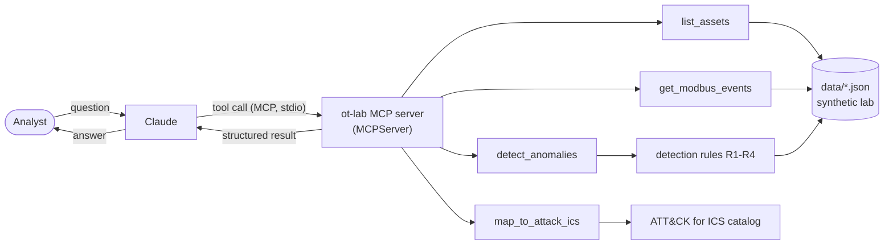

# OT Lab MCP Server

> 🇵🇱 Wersja polska: [README.pl.md](README.pl.md)

An [MCP](https://modelcontextprotocol.io) (Model Context Protocol) server that gives Claude read-only
access to a **fully synthetic industrial (OT/ICS) lab**, so Claude can investigate it like a SOC analyst:
inventory the network, find suspicious Modbus traffic, pull the evidence and map findings to
**MITRE ATT&CK for ICS**.

> **Everything here is fictional.** Devices, vendors, addresses and traffic are generated by
> [`scripts/generate_data.py`](scripts/generate_data.py). No real systems, no real customer or employer data,
> and the server never touches the network. It is a portfolio / learning project, not a production monitor.

## How it works

Claude does not see the lab by itself. The MCP server is a small program that Claude's host application
(Claude Desktop / Claude Code) starts in the background and talks to over stdio. Claude decides which tool to
call, the server computes the answer from JSON files and returns it.



## Tools

All tools are **read-only**, take no file paths and make no network calls (declared in the tool annotations
and enforced by tests).

| Tool | What it does |
|---|---|
| `list_assets` | Lists the 13 fictional devices (PLC, RTU, HMI, switches, engineering workstation, historian, DMZ hosts) with IP, vendor, model, firmware, zone and Purdue level. Filter by zone and device type. |
| `get_modbus_events` | Returns Modbus/TCP transactions from the last *N* hours, filterable by source, destination and function code. Events come with the function name, `is_write` flag and device names. |
| `detect_anomalies` | Runs the detection rules over a time window and returns anomalies, most severe first, each with evidence event ids. |
| `map_to_attack_ics` | Maps an anomaly (or a whole rule) to MITRE ATT&CK for ICS techniques with tactics, link, confidence and rationale. |

### Detection rules

| Rule | Detects | Severity |
|---|---|---|
| **R1** | Write to a device from a host that the policy does not list as an authorized writer | high |
| **R2** | One host contacts ≥ 10 different targets in a short burst (network scan) | medium |
| **R3** | Function code outside the lab baseline (FC 8 diagnostics = high, others = medium) | high / medium |
| **R4** | Written value outside the register's allowed range | critical |

### ATT&CK for ICS mapping

| Finding | Technique | Confidence |
|---|---|---|
| R1 unauthorized write | T1692.001 Unauthorized Message: Command Message | high |
| R2 network scan | T0846 Remote System Discovery | high |
| R3, FC 17 / 43 | T0888 Remote System Information Discovery | high |
| R3, FC 8 | T0814 Denial of Service | medium |
| R4 out-of-range write | T0836 Modify Parameter | high |

The technique IDs were checked against attack.mitre.org on 2026-11-03 (not written from memory). One finding
worth knowing: the older ID *T0855 Unauthorized Command Message* does not appear in the current ICS matrix,
where `T1692.001` is the matching entry. ATT&CK numbering changes, so re-verify
[`src/ot_mcp/attack_ics.py`](src/ot_mcp/attack_ics.py) when updating.

## The built-in scenario

The dataset is 12 hours of quiet baseline traffic (HMIs and a historian polling PLCs, a few authorized
setpoint changes) plus a three-phase attack from a jump host in the DMZ. The data has no "malicious" label:
finding the attack is the job of the detection rules.

| ~ Time before "now" | Phase | Caught by |
|---|---|---|
| 110 min | Scan of `192.168.10.1-40` with Modbus device-identification requests | R2, R3 |
| 75 min | Four writes to `PLC-02` from an unauthorized host, two with absurd values | R1, R4 |
| 30 min | Modbus diagnostics (restart communications, listen-only) against `PLC-02` | R3 |

Tests assert that all phases are detected **and** that the baseline alone produces zero alerts.

## Quick start

Requirements: Python ≥ 3.10 and [uv](https://docs.astral.sh/uv/).

```bash
uv sync
uv run pytest          # 143 tests, including a real stdio server process
uv run ruff check .
uv run python -m ot_mcp   # starts the server on stdio (normally Claude does this for you)
```

### Connect it to Claude Code / Claude Desktop

Create a `.mcp.json` in the project root (a template is in [`.mcp.json.example`](.mcp.json.example)):

```json
{
  "mcpServers": {
    "ot-lab": {
      "command": "uv",
      "args": ["run", "--directory", "/absolute/path/to/this/repo", "python", "-m", "ot_mcp"]
    }
  }
}
```

Open a **new** session in the project folder (servers are loaded at session start) and approve the `ot-lab`
server when asked. Then try: *"Analyze the OT lab and point out signs of an attack."*

### Example investigation

Claude's wording will vary; the tool results below are real output of this server (`hours=6`).

1. `detect_anomalies` → 6 anomalies from 290 events, all from `JUMP-01`:
   - `critical` `R4:JUMP-01->PLC-02:reg1` - wrote `[9999, 65535]` to register 1 (`dosing_rate_ml_min`), allowed 0..250
   - `high` `R1:JUMP-01->PLC-02` - 4 writes from a host that is not an authorized writer
   - `high` `R3:JUMP-01:FC8` - Modbus diagnostics (DoS risk)
   - `medium` `R2:JUMP-01@2026-11-03T10:10Z` - 40 hosts contacted in a burst, 37 timed out
   - `medium` `R3:JUMP-01:FC43`, `R3:JUMP-01:FC17` - device fingerprinting
2. `get_modbus_events(src="JUMP-01")` → the raw timeline behind each anomaly.
3. `map_to_attack_ics(anomaly_id="R1:JUMP-01->PLC-02")` → `T1692.001` with rationale.
4. `list_assets(zone="level_3_5_dmz")` → `JUMP-01` is a DMZ host talking directly to Level 1 controllers.

## Design notes

- **MCP SDK 2.x.** The official Python SDK renamed `FastMCP` to `MCPServer` in 2.x; this project uses
  `mcp.server.mcpserver.MCPServer` with the same decorator style.
- **Errors must be `ToolError`.** In SDK 2.x a plain `ValueError` raised inside a tool reaches the model only
  as "Error executing tool", hiding hints such as the list of allowed values. `server.py` converts validation
  errors to `ToolError`, and a test guards that the message reaches the client.
- **Deterministic time.** "Last N hours" is counted from a reference time stored in the dataset, not from the
  wall clock, so results and tests never drift.
- **Rules are small pure functions** (`src/ot_mcp/detection/rules.py`); adding a rule means writing a function
  and listing it in `ALL_RULES`.
- **Data is untrusted for the model.** Text from the JSON files reaches Claude's context, so the data contains
  no instructions, and the server's instructions tell the model to treat tool output as data.
- **Fails fast.** The data is validated at startup (types, private IPs only, `synthetic: true`, cross-file
  consistency), so a broken file is reported immediately rather than in the middle of an analysis.

## Limitations and ideas

- R2 splits traffic into bursts (gap > 5 min starts a new one), so a very slow scan is not detected.
- R4 knows only the first value of multi-register writes (FC 15/16).
- Only Modbus/TCP; one scenario. Ideas: more scenarios, S7 / DNP3 / OPC UA, streamable HTTP transport
  with authentication, MCP resources and prompts (e.g. an incident-triage prompt), baselining instead of a
  hand-written policy.

## Project layout

```
data/                 synthetic lab: assets.json, modbus_events.json, policy.json
scripts/              generate_data.py (deterministic, seeded)
src/ot_mcp/
  server.py           MCPServer, tool registration, stdio entry point
  models.py           Pydantic models (Asset, ModbusEvent, Anomaly, policy)
  data_loader.py      loading + cross-file validation
  detection/rules.py  rules R1-R4
  attack_ics.py       verified ATT&CK for ICS catalog and mapping
  tools/              tool logic (assets, events, anomalies, attack_mapping)
tests/                143 tests
CLAUDE.md             project rules for Claude Code
```

## License

MIT, see [LICENSE](LICENSE).
