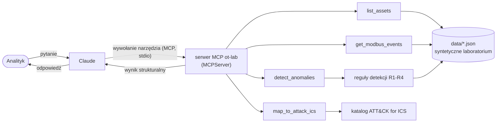

# Serwer MCP „OT Lab"

> 🇬🇧 English version: [README.md](README.md)

Serwer [MCP](https://modelcontextprotocol.io) (Model Context Protocol), który daje Claude'owi dostęp
tylko do odczytu do **w pełni syntetycznego laboratorium przemysłowego (OT/ICS)**. Claude może je zbadać
jak analityk SOC: zrobić inwentarz sieci, znaleźć podejrzany ruch Modbus, zebrać dowody i zmapować
wnioski na **MITRE ATT&CK for ICS**.

> **Wszystko tu jest fikcyjne.** Urządzenia, producenci, adresy i ruch pochodzą z generatora
> [`scripts/generate_data.py`](scripts/generate_data.py). Żadnych prawdziwych systemów, danych klientów
> ani pracodawcy, a serwer nigdy nie korzysta z sieci. To projekt portfolio i do nauki, a nie produkcyjny monitoring.

## Jak to działa

Claude sam z siebie nie widzi laboratorium. Serwer MCP to mały program, który aplikacja Claude (Claude Desktop
albo Claude Code) uruchamia w tle i z którym rozmawia przez stdio. Claude decyduje, którego narzędzia użyć,
a serwer liczy odpowiedź z plików JSON i ją zwraca.



## Narzędzia

Wszystkie narzędzia są **tylko do odczytu**, nie przyjmują ścieżek do plików i nie łączą się z siecią
(zadeklarowane w adnotacjach narzędzi i wymuszone testami).

| Narzędzie | Co robi |
|---|---|
| `list_assets` | Lista 13 fikcyjnych urządzeń (PLC, RTU, HMI, switche, stacja inżynierska, historian, hosty w DMZ) z IP, producentem, modelem, firmware, strefą i poziomem Purdue. Filtry: strefa i typ urządzenia. |
| `get_modbus_events` | Transakcje Modbus/TCP z ostatnich *N* godzin, filtrowane po nadawcy, odbiorcy i kodzie funkcji. Zdarzenia mają nazwę funkcji, flagę `is_write` i nazwy urządzeń. |
| `detect_anomalies` | Uruchamia reguły detekcji w oknie czasowym i zwraca anomalie od najpoważniejszej, każdą z identyfikatorami zdarzeń jako dowodami. |
| `map_to_attack_ics` | Mapuje anomalię (lub całą regułę) na techniki MITRE ATT&CK for ICS wraz z taktykami, linkiem, pewnością i uzasadnieniem. |

### Reguły detekcji

| Reguła | Wykrywa | Waga |
|---|---|---|
| **R1** | Zapis do urządzenia z hosta, którego polityka nie wymienia jako uprawnionego | high |
| **R2** | Jeden host kontaktuje ≥ 10 różnych celów w krótkiej serii (skan sieci) | medium |
| **R3** | Kod funkcji spoza listy normalnej w laboratorium (FC 8 diagnostyka = high, pozostałe = medium) | high / medium |
| **R4** | Zapisana wartość poza dozwolonym zakresem rejestru | critical |

### Mapowanie na ATT&CK for ICS

| Wykrycie | Technika | Pewność |
|---|---|---|
| R1 nieautoryzowany zapis | T1692.001 Unauthorized Message: Command Message | high |
| R2 skan sieci | T0846 Remote System Discovery | high |
| R3, FC 17 / 43 | T0888 Remote System Information Discovery | high |
| R3, FC 8 | T0814 Denial of Service | medium |
| R4 zapis poza zakresem | T0836 Modify Parameter | high |

Identyfikatory technik sprawdziłem na attack.mitre.org w dniu 2026-11-03 (nie wpisałem ich z pamięci).
Warto wiedzieć: starszego identyfikatora *T0855 Unauthorized Command Message* nie ma w aktualnej macierzy ICS,
a odpowiada mu `T1692.001`. Numeracja ATT&CK się zmienia, więc przy aktualizacji zweryfikuj ponownie
[`src/ot_mcp/attack_ics.py`](src/ot_mcp/attack_ics.py).

## Wbudowany scenariusz

Zbiór danych to 12 godzin spokojnego ruchu bazowego (HMI i historian odpytują sterowniki, kilka
autoryzowanych zmian nastaw) oraz atak w trzech fazach z jump hosta w DMZ. W danych nie ma etykiety
„złośliwe": znalezienie ataku to zadanie reguł detekcji.

| ~ Czas przed „teraz" | Faza | Wykrywa |
|---|---|---|
| 110 min | Skan `192.168.10.1-40` zapytaniami o identyfikację urządzenia Modbus | R2, R3 |
| 75 min | Cztery zapisy do `PLC-02` z nieautoryzowanego hosta, dwa z absurdalnymi wartościami | R1, R4 |
| 30 min | Diagnostyka Modbus (restart komunikacji, tryb listen-only) przeciw `PLC-02` | R3 |

Testy sprawdzają, że wszystkie fazy zostają wykryte **oraz** że sam ruch bazowy nie daje żadnego alarmu.

## Szybki start

Wymagania: Python ≥ 3.10 i [uv](https://docs.astral.sh/uv/).

```bash
uv sync
uv run pytest          # 143 testy, w tym prawdziwy proces serwera przez stdio
uv run ruff check .
uv run python -m ot_mcp   # uruchamia serwer na stdio (normalnie robi to za Ciebie Claude)
```

### Podłączenie do Claude Code / Claude Desktop

Utwórz w katalogu głównym plik `.mcp.json` (wzór w [`.mcp.json.example`](.mcp.json.example)):

```json
{
  "mcpServers": {
    "ot-lab": {
      "command": "uv",
      "args": ["run", "--directory", "/absolutna/sciezka/do/repo", "python", "-m", "ot_mcp"]
    }
  }
}
```

Otwórz **nową** sesję w folderze projektu (serwery wczytują się przy starcie sesji) i zatwierdź serwer `ot-lab`,
gdy aplikacja o to zapyta. Potem spróbuj: *„Przeanalizuj laboratorium OT i wskaż ślady ataku."*

### Przykładowe śledztwo

Sformułowania Claude'a będą się różnić; poniższe wyniki narzędzi to prawdziwe wyjście tego serwera (`hours=6`).

1. `detect_anomalies` → 6 anomalii z 290 zdarzeń, wszystkie z `JUMP-01`:
   - `critical` `R4:JUMP-01->PLC-02:reg1` - zapis `[9999, 65535]` do rejestru 1 (`dosing_rate_ml_min`), dozwolone 0..250
   - `high` `R1:JUMP-01->PLC-02` - 4 zapisy z hosta, który nie jest uprawniony
   - `high` `R3:JUMP-01:FC8` - diagnostyka Modbus (ryzyko DoS)
   - `medium` `R2:JUMP-01@2026-11-03T10:10Z` - 40 hostów w serii, 37 bez odpowiedzi
   - `medium` `R3:JUMP-01:FC43`, `R3:JUMP-01:FC17` - rozpoznawanie urządzeń
2. `get_modbus_events(src="JUMP-01")` → surowa oś czasu za każdą anomalią.
3. `map_to_attack_ics(anomaly_id="R1:JUMP-01->PLC-02")` → `T1692.001` z uzasadnieniem.
4. `list_assets(zone="level_3_5_dmz")` → `JUMP-01` to host w DMZ rozmawiający bezpośrednio ze sterownikami poziomu 1.

## Decyzje projektowe

- **SDK MCP 2.x.** Oficjalny SDK Pythona zmienił nazwę `FastMCP` na `MCPServer`; projekt używa
  `mcp.server.mcpserver.MCPServer` w tym samym stylu dekoratorów.
- **Błędy muszą być `ToolError`.** W SDK 2.x zwykły `ValueError` rzucony w narzędziu dociera do modelu tylko
  jako „Error executing tool", co gubi podpowiedzi (np. listę dozwolonych wartości). `server.py` zamienia błędy
  walidacji na `ToolError`, a test pilnuje, żeby komunikat docierał do klienta.
- **Deterministyczny czas.** „Ostatnie N godzin" liczymy od czasu odniesienia zapisanego w danych, a nie od
  zegara systemowego, więc wyniki i testy się nie rozjeżdżają.
- **Reguły to małe czyste funkcje** (`src/ot_mcp/detection/rules.py`); nowa reguła to napisanie funkcji
  i dopisanie jej do `ALL_RULES`.
- **Dane są niezaufane dla modelu.** Tekst z plików JSON trafia do kontekstu Claude'a, więc dane nie zawierają
  żadnych instrukcji, a instrukcje serwera każą modelowi traktować wynik narzędzi jak dane.
- **Szybka porażka.** Dane są walidowane przy starcie (typy, tylko prywatne IP, `synthetic: true`, spójność
  między plikami), więc uszkodzony plik wychodzi od razu, a nie w środku analizy.

## Ograniczenia i pomysły

- R2 dzieli ruch na serie (przerwa > 5 min zaczyna nową), więc bardzo powolny skan nie zostanie wykryty.
- R4 zna tylko pierwszą wartość zapisu wielu rejestrów (FC 15/16).
- Tylko Modbus/TCP i jeden scenariusz. Pomysły: kolejne scenariusze, S7 / DNP3 / OPC UA, transport streamable
  HTTP z uwierzytelnianiem, zasoby i prompty MCP (np. prompt do triage'u incydentu), baseline zamiast ręcznie
  napisanej polityki.

## Struktura projektu

```
data/                 syntetyczne laboratorium: assets.json, modbus_events.json, policy.json
scripts/              generate_data.py (deterministyczny, ze stałym seedem)
src/ot_mcp/
  server.py           MCPServer, rejestracja narzędzi, punkt wejścia stdio
  models.py           modele Pydantic (Asset, ModbusEvent, Anomaly, polityka)
  data_loader.py      wczytywanie i walidacja spójności między plikami
  detection/rules.py  reguły R1-R4
  attack_ics.py       zweryfikowany katalog ATT&CK for ICS i mapowanie
  tools/              logika narzędzi (assets, events, anomalies, attack_mapping)
tests/                143 testy
CLAUDE.md             zasady projektu dla Claude Code
```

## Licencja

MIT, zobacz [LICENSE](LICENSE).
